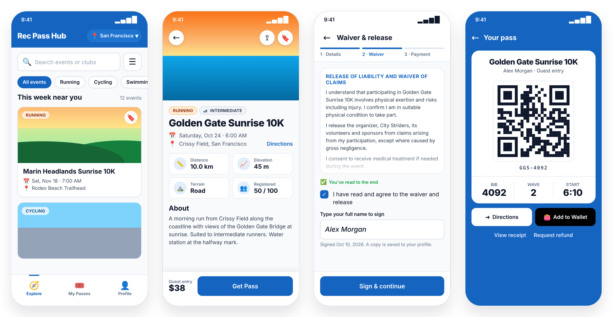
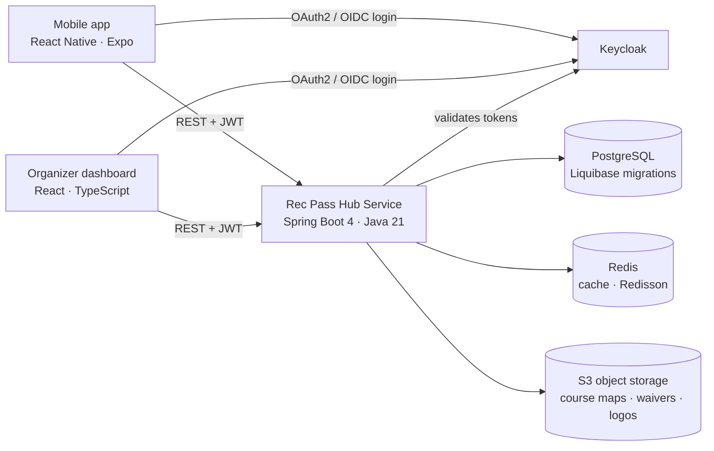

# Rec Pass Hub Service

The backend API for **Rec Pass Hub**, a platform where people discover local running, cycling, swimming and triathlon events, sign waivers, and carry their event pass on their phone. Organizers use the same API to publish events, upload course maps and manage check-in.

    



*Hi-fi designs for the [mobile app](https://github.com/dalyodhran/recpasshub-app) these endpoints power: explore nearby events, view event details, sign the waiver at checkout, and show a QR pass on race day.*

## Architecture



- **Authentication** is delegated to Keycloak. The service is an OAuth2 resource server: it validates JWTs, checks the token audience, and maps Keycloak roles and claims to Spring Security authorities.
- **PostgreSQL** holds users, events, waivers, maps, logos and tags. The schema is versioned with Liquibase changelogs in `src/main/resources/config/liquibase`.
- **Redis** (through Redisson) backs Spring's cache layer.
- **S3-compatible storage** holds uploaded files. Locally it points at LocalStack on port 4566; in production it uses AWS S3.

## Features

- **Events:** create, update, publish (`DRAFT` → `PUBLISHED`) and delete events with sport type, terrain, capacity, start and end times, tags, and a linked course map, waiver and logo.
- **Nearby search:** find events within a radius of a latitude and longitude (`GET /api/v1/events/nearby`), with input validation on coordinates.
- **Course maps:** organizers upload a GPX file. The service parses it with [JPX](https://github.com/jenetics/jpx) to work out distance, elevation gain and start location, and stores the file in S3.
- **Waivers:** upload and serve event waivers, so attendees can sign one during checkout.
- **Users:** registration and profile endpoints linked to the Keycloak identity.
- **Organizer branding:** logo upload and retrieval.

## API

All endpoints sit under `/api/v1` and need a Keycloak bearer token. OpenAPI docs are served at `/v3/api-docs` and through Swagger UI in the dev profile.

| Resource | Endpoints |
|---|---|
| Events | `GET /events`, `GET /events/nearby?latitude=&longitude=&radius=`, `GET /events/{id}`, `POST /events`, `PUT /events/{id}`, `DELETE /events/{id}` |
| Maps | `POST /maps` (multipart GPX upload), `GET /maps/{guid}` |
| Waivers | `POST /waivers` (multipart upload), `GET /waivers/{guid}` |
| Logos | `POST /logos` (multipart upload), `GET /logos/{guid}` |
| Users | `POST /users/registerUser`, `GET /users/me` |

## Tech stack

| Area | Tools |
|---|---|
| Language and framework | Java 21, Spring Boot 4, Spring Security (OAuth2 resource server), Spring Data JPA / Hibernate |
| Data | PostgreSQL, Liquibase, Redis (Redisson) |
| Storage | AWS SDK v2 for S3, LocalStack for local development |
| Auth | Keycloak (OAuth2 / OpenID Connect) |
| Quality | JUnit 5, Testcontainers, Checkstyle, Prettier, Husky pre-commit hooks, SonarQube |
| Build and CI | Gradle, GitHub Actions (build and test on every push), Jib for container images |

The project was bootstrapped with [JHipster](https://www.jhipster.tech/), and the domain model, API and services on top of it are my own.

## Running locally

**Prerequisites:** Java 21, Docker, and the compose files from [recchubpass-docker](https://github.com/dalyodhran/recchubpass-docker).

1. Start PostgreSQL, Keycloak and Redis:
   ```bash
   docker compose -f services.yml up -d
   ```
   Keycloak runs on http://localhost:9080 with a preconfigured realm.
2. For file uploads, start LocalStack S3 on port 4566 and create the buckets named in `application-dev.yml`.
3. Run the service with the dev profile:
   ```bash
   ./gradlew
   ```
   The API is available on http://localhost:8080.

### Tests

```bash
./gradlew test             # unit tests
./gradlew integrationTest  # integration tests (uses Testcontainers)
```

## Related repositories

- [recpasshub-app](https://github.com/dalyodhran/recpasshub-app): React Native mobile app for attendees and organizers
- [recpasshub-ui](https://github.com/dalyodhran/recpasshub-ui): organizer web dashboard
- [recchubpass-docker](https://github.com/dalyodhran/recchubpass-docker): Docker Compose stack for local development and monitoring (Prometheus and Grafana)

## Author

Built by **Odhrán Daly**: [portfolio](https://www.odhran.ca) · [LinkedIn](https://www.linkedin.com/in/odhrandaly)
